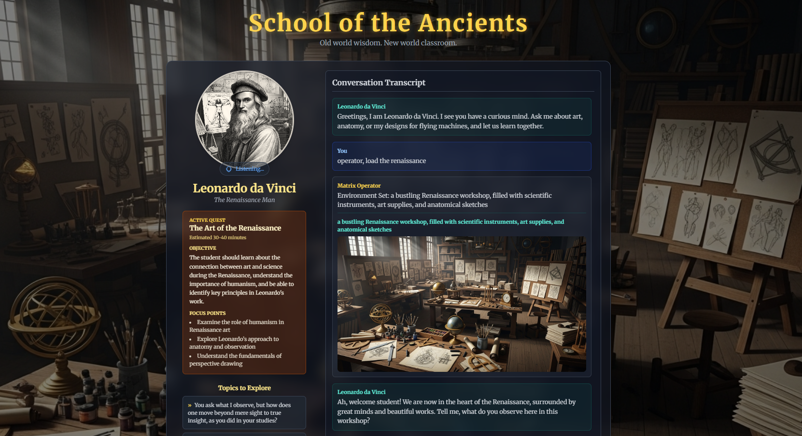

New quests now prepare one focused educational exhibit request alongside the mentor introduction. The full saved prompt is visible and editable; Matrix/image/Blender execution remains not connected. Older quests offer an explicit preparation button. See [automatic preparation validation](docs/AUTOMATIC_EXHIBIT_VALIDATION.md) and [Matrix integration recommendation](docs/MATRIX_INTEGRATION_RECOMMENDATION.md).

## ChatGPT subscription beta rebuild (local phase one)

The default entry now uses `src/school/SchoolApp.tsx` with a local server-side
native Codex provider using ChatGPT sign-in. Start with any learning goal, choose or suggest a
historical mentor, converse, take an objective-linked knowledge check, review
missed concepts, and retry. Successful turns and assessments survive a server or
browser reload. No microphone, Google key, or Supabase account is required.

```powershell
npm ci
npm run dev
```

Open `http://127.0.0.1:3000`. Run School under the computer account with your
existing Codex-managed ChatGPT sign-in. The native CLI is discovered locally;
the adapter's invocation and one synthetic teaching turn are verified with
installed Codex `0.159.0`. Optional server-only
`SCHOOL_CODEX_EXE` selects a native executable; `SCHOOL_CODEX_MODEL` selects a
model (default `gpt-6.1-sol`). A completed turn, not a catalog or login check,
verifies model access. No API key is required, accepted by this adapter, or used
as fallback. If Codex reports no ChatGPT login, the owner must run `codex login`
locally before clicking **Recheck local Codex**. School never starts login or
reads/extracts tokens. Do not paste credentials into the browser.

The former API Responses adapter is retained only as inactive, mock-tested code
for a future explicit provider decision. It is not selected by the running app,
reads no environment credentials, and is never a fallback. No voice/API billing
or key setup is enabled by this checkpoint.

Your subscription, model and workspace limits apply. This depends on the local
computer, native Codex, network and running School server; it is not an unlimited
public SaaS entitlement. No ChatGPT conversation history or account memory is
imported. This work did not change sign-in, credentials, permissions or billing.

```powershell
npm run test:server
npm run test:run
npm run typecheck:school
npm run check:codex
npm run build
npm run preview
```

`npm run check:codex` performs only a native compatibility/login check.
`npm run smoke:codex` explicitly opts into one small synthetic subscription
teaching turn. Automated tests use mocked model execution and never call a model.

This is a loopback-only local prototype, not a public service. `npm run preview`
also runs the local API; uploading `dist/` alone does not provide teaching.
Do not expose the Vite server or this API to the network. Learning records and
server-only quiz keys live in ignored `.school-data/`, linked to a long-lived
HttpOnly browser cookie. They are plaintext local files, not encrypted cloud
sync. Clearing the cookie loses browser access. Use **Export learning record**
for records you want to keep. Existing beta/Supabase records are untouched;
automatic migration is not implemented.

[EACL 2026 Instructional Agents curriculum-creator research](docs/RESEARCH_INSTRUCTIONAL_AGENTS_EACL26.md) is a separate evaluation proposal; no new course generator or API billing is enabled by this checkpoint.

[Rebuild design, review, limits and validation](docs/OPENAI_REBUILD.md) is the
current implementation record. The Gemini/Supabase code below remains as legacy
reference and regression coverage; it is not mounted by the new entry. Voice,
image generation, Matrix and Blender are excluded from this phase. The original
README below describes the historical beta, not the new runtime.

[One live subscription browser loop](docs/VALIDATION_SUBSCRIPTION_LOOP_2026-10-21.md)
passed through intentional miss, focused review, retry, server restart/reopen and
verified export. This is one local acceptance path, not proof of lasting mastery.

---

# 📚 School of the Ancients 

> *Old world wisdom. New world classroom.*  
> An open-source **Living Educational Operating System** that merges ancient philosophy with modern AI to create a personalized, adaptive, and Socratic learning experience.



---

## 🏛️ Overview

School of the Ancients (SotA) revives the timeless methods of learning — dialogue, mentorship, reflection — and reimagines them for the AI age.  
Students don’t consume lessons. They *create quests*, summon *mentors*, and engage in *Socratic conversations* that grow their understanding over time.

Every curiosity becomes a course.  
Every learner builds their own academy.

---

## ✨ Key Features

| Feature | Description |
|----------|-------------|
| **Find Your Goal** | Reflective dialogue to uncover each learner’s purpose before learning begins. |
| **Dynamic Quests** | Personalized quests created from any learning goal. |
| **AI Mentors** | Historically inspired AI teachers who guide students through Socratic dialogue. |
| **Socratic Dialogue Engine** | A question-based learning model that evaluates understanding in real time. |
| **Questsmith & Mentor Kernel** | Systems that generate new quests and mentors dynamically. |
| **Career Pathfinder** | Analyzes all learning to propose meaningful career directions and next-step skills. |
| **Living Curriculum** | Each learner’s path evolves from their own curiosity and reflections. |

---

## 🧠 Architecture Overview

The system operates as a **living loop** of learning:

```
Find Goal → Create Quest → Summon Mentor → Dialogue → Reflect → Assess → Next Quest
```

### Core Modules
- `CharacterCreator.tsx` – AI Mentor Generator  
- `QuestCreator.tsx` – Questsmith Engine  
- `ConversationView.tsx` – Socratic Dialogue Runtime  
- `QuestQuiz.tsx` – Assessment & Mastery Engine  
- `HistoryView.tsx` – Reflection Archive  
- `CareerRoute.tsx` – Career Pathfinder (in development)

---

## ⚙️ Tech Stack

| Layer | Tools |
|--------|-------|
| **Frontend** | React, Tailwind, Vite |
| **AI Integration** | Google Gemini (2.5 Flash / Imagen 4.0) |
| **Backend** | Supabase (Auth, DB, Storage) |
| **Data Storage** | Encrypted local storage + cloud sync supabase |
| **Environment Engine** | Imagen 4.0 for visual scenes + ambient audio |
| **Voice** | Gemini Live + custom hooks (`useGeminiLive`, `useAmbientAudio`) |

---

## 📁 Documentation Index

| File | Purpose |
|------|----------|
| [`MANIFESTO.md`](./docs/MANIFESTO.md) | The philosophical foundation — “A Living Educational OS.” |
| [`SOTA_CORE_GOAL.md`](./docs/SOTA_CORE_GOAL.md) | Defines SotA’s goal, problems solved, and unique value. |
| [`SOTA_MISSION_STATEMENT.md`](./docs/SOTA_MISSION_STATEMENT.md) | Mission, solution, and vision overview. |
| [`LIVING_EDUCATIONAL_OS.md`](./docs/LIVING_EDUCATIONAL_OS.md) | Explains SotA as a Living Operating System for learning. |
| [`CAREER_PATHFINDER.md`](./docs/CAREER_PATHFINDER.md) | Translates learning data into ideal careers and next-step quests. |
| [`LEARNING_METHOD.md`](./docs/LEARNING_METHOD.md) | Connects SotA to the scientific method — learning as experimentation. |
| [`ROADMAP.md`](./docs/ROADMAP.md) | Implementation timeline and version goals. | 


---

## 🜂 Core Philosophy

> **Education should not end with answers.**  
> It should begin with better questions.

SotA returns learning to its ancient roots — curiosity, conversation, and character — while giving every student a personal mentor, unique curriculum, and infinite room to grow.

---

## 🌍 Contribute

- Fork the repo: `github.com/School-of-the-Ancients/sota-beta`  
- Join discussions under **Issues → Philosophy or Product Ideas.**  
- Share reflections, prompts, or new mentor templates.

---

## 🧭 Vision

To build a **universal academy of wisdom** — where every human and AI can learn, reflect, and evolve through dialogue.

> *Learning, like the soul, should be infinite.*

The seven original prompt areas have since been restored in the active local
app: eleven individual selectable personas, rich quest planning and separate
mentor-fit review, fully assembled teaching context, inert Operator presentation
prompts, the improved quiz, independent evidence-grounded conversation review,
and reusable custom historical teachers with a separate plausibility check.
See the restoration section in `docs/OPENAI_REBUILD.md`. Media execution remains
deferred; pending requests are not created images or scenes. Existing saved
lessons remain compatible without a database migration.
Local Operator image/background requests are now connected in the isolated Matrix
candidate; see [connection and evidence](docs/OPERATOR_CONNECTION.md). The complete
School interface and standalone teaching path remain intact. Current Leonardo
data on 3108 was not migrated or overwritten.
